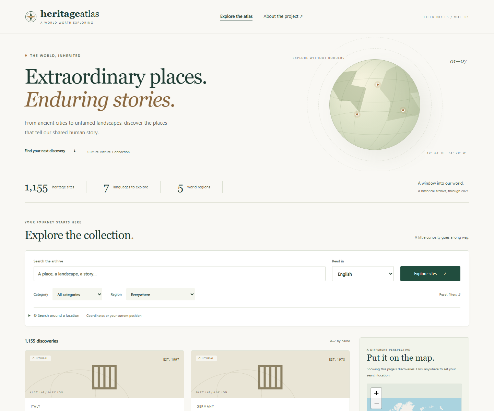
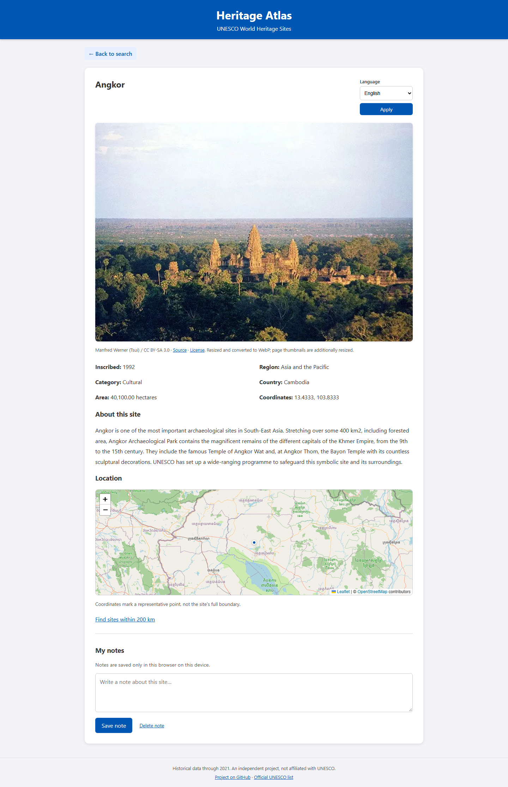

# Heritage Atlas

A Flask and MongoDB app for browsing UNESCO World Heritage Sites. It started as my ISTE 438 database project at RIT. The updated version keeps the original blue styling and map layout, with better search, site photos, and automated tests.



## Features

- Search site names and descriptions by keyword, category, and region.
- Find nearby sites using coordinates and a radius, with results ordered by distance.
- Browse records in seven languages and see sites on an interactive map.
- Read site details and save private notes in your browser.
- View images for all 1,155 sites, stored in MongoDB GridFS with source credits.
- Access the same search through a paginated REST API.



## Run locally

Requires Python 3.10+. On Windows, double-click **Start-Demo.cmd**, or run:

```powershell
python -m venv .venv
.venv\Scripts\python -m pip install -r requirements.txt
.venv\Scripts\python scripts/install_mongodb.py
.venv\Scripts\python scripts/run_local.py
```

Open [localhost:5050](http://localhost:5050). The app runs directly with native MongoDB and Python/Waitress. The launcher creates local credentials and imports the data on startup. Press Ctrl+C to stop it; the database stays in `.runtime/data/`.

The MongoDB installer supports Windows x64 and Ubuntu 24.04 x64. You can also use an existing MongoDB or Atlas database by setting `MONGO_URI` and `MONGO_DB`. See [setup and operations](docs/OPERATIONS.md).

## Data

The original coursework snapshot contains **1,155 sites and 5,639 records across seven languages**, with inscription years through 2021. It is a historical dataset, not the current UNESCO list. Translations are machine generated and coverage varies by site. Site images are bundled and imported into GridFS automatically, including small result thumbnails.

[Data sources and limitations](docs/DATA_SOURCES.md) · [Dataset counts and checksum](data/manifest.json)

## Tests

Start the app, then run:

```powershell
.venv\Scripts\python -m pip install -r requirements-dev.txt
.venv\Scripts\python scripts/check.py -q
```

The suite has **47 tests**, using a separate real MongoDB test database. Browser checks cover search, translations, notes, mobile layouts, and error states. GitHub Actions runs the checks on Ubuntu with native MongoDB.

[Validation details](docs/VALIDATION.md) · [CI runs](https://github.com/muzammilkhan2784/UNESCO-World-Heritage-Explorer/actions)

## Project notes

[Architecture](docs/ARCHITECTURE.md) · [API](docs/API.md) · [Operations](docs/OPERATIONS.md) · [Resume bullets and demo walkthrough](docs/CAREER_FAIR.md)

This is an independent portfolio project, not an official UNESCO application. The demo runs locally; public hosting is not configured.
