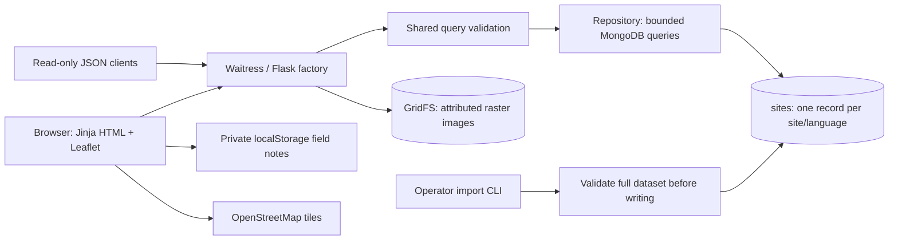

# Architecture

## Boundaries

- `heritage/__init__.py`: app factory, routes, errors, headers, request IDs, health checks. No index creation at worker startup.
- `heritage/validation.py`: query parsing, finite coordinate and radius validation, pagination limits, supported languages/categories.
- `heritage/repository.py`: persistence, projections, aggregation pipelines, GridFS lookup, and short-lived metadata cache.
- `heritage/ingestion.py`: legacy-to-canonical normalization, operator CLI, full-file validation, unique-key upserts.
- `scripts/prepare_dataset.py`: reproducible BSON conversion to compressed JSON plus integrity manifest.
- `templates/`, `static/`: responsive server-rendered interface, safe DOM map popups, local field notes, progressively enhanced search.

## Data model

Each site/translation document has `site_id`, `language`, `name`, plain-text `description`, `year`, `category`, `country`, a display `region`, an array of `regions`, nullable `area_hectares`, and `location: {type: "Point", coordinates: [longitude, latitude]}`. Translation provenance is carried in `translation_note`. Optional image references include attribution and source metadata.

The unique compound `(site_id, language)` index prevents duplicate translations. A `2dsphere` index supports spherical nearby queries. Compound language/name and language/category/name indexes support browsing; substring search also examines descriptions and is not equivalent to full-text indexed search.

Source records span five UNESCO regions. Three transcontinental sites have multiple memberships; an array filter includes them in every applicable region. Metadata counts unique site IDs separately from translation documents. Missing translations do not create invented records or silently substitute English.

## Search execution

Ordinary search matches the selected language and optional literal keyword/category/region, sorts by name and stable site ID, then facets into a paginated result list and a count. Nearby search starts with `$geoNear`, with its filters inside the stage, and sorts by distance then site ID before the same facet. Distances are calculated from representative site points, not site polygons.

The API defaults to 12 records and caps page size at 48 and page number at 1,000. Query text has a 120-character limit and is escaped before use in MongoDB regex. A three-second MongoDB `maxTimeMS` bounds search execution; connection selection and socket timeouts also bound database failures. The count facet still examines all matching records. Offset pagination and substring matching are reasonable for this historical snapshot; larger datasets would need cursor pagination and a dedicated multilingual search index.

## State and trust

GET query strings are the source of truth for shareable searches. Browser session storage remembers the last search for the back link. Local storage holds private field notes by stable site ID; storage failure is handled and no notes are uploaded. These notes are convenient device-local text, not confidential or encrypted storage.

There are no application write endpoints, sessions, public comments, or authentication flows. Imports run as operator commands. Browser text is escaped by Jinja, map data uses Jinja's JSON serializer, and popups use `textContent` instead of untrusted HTML. Raster image imports require attribution and a source URL and reject non-image signatures and payloads over 10 MB. This signature check is a trusted operator convenience, not a public upload validation service.

The local launcher runs native MongoDB bound to loopback with authentication, using a separate project-local data directory. MongoDB authenticates a database-scoped application user. The web worker and import CLI currently share that readWrite account; production can give web workers a read-only user and use a separate importer credential. No credentials, original comments, or unlicensed legacy images are included in the portable data snapshot.

## Reliability and observability

Liveness checks the web process; readiness checks MongoDB, dataset presence, and the geospatial index. Readiness is an operational minimum, not a complete data audit; the manifest test verifies snapshot integrity separately. Request logs contain request ID, method, path, status, and duration, with no query strings or database credentials. Database errors return a generic 503 and correlation ID. Metadata is cached for 60 seconds per worker and invalidated by in-process imports.

Leaflet assets are local. Tile network failure does not block search or detail rendering. Missing GridFS files use a local illustration, and successful image responses have ETags and cache headers. The app uses Waitress rather than Flask's development server.

References: [MongoDB `$geoNear`](https://www.mongodb.com/docs/manual/reference/operator/aggregation/geonear/), [Flask security considerations](https://flask.palletsprojects.com/en/stable/web-security/).
